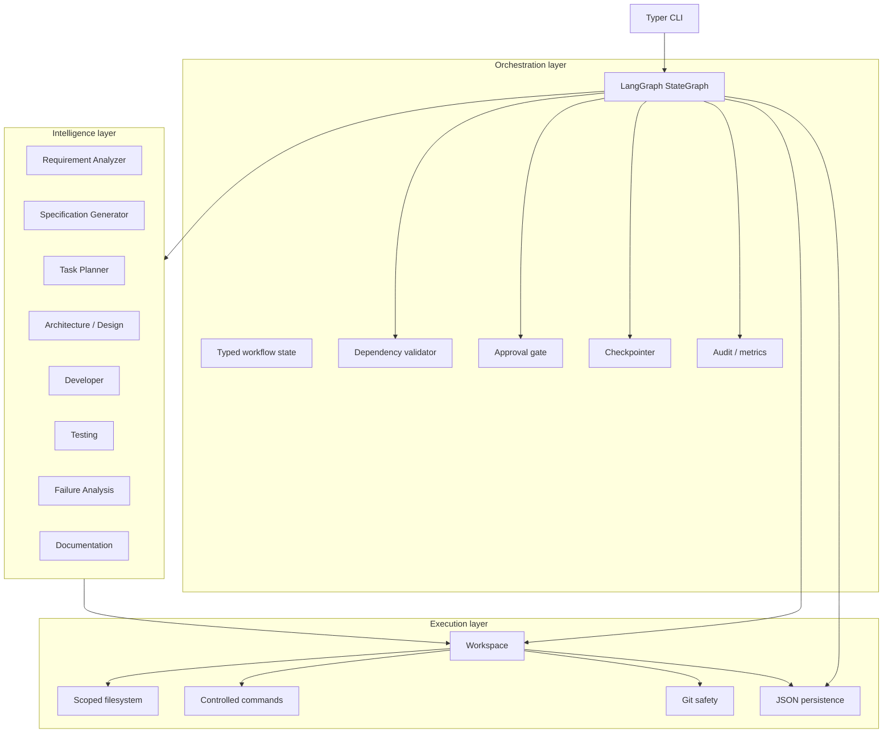
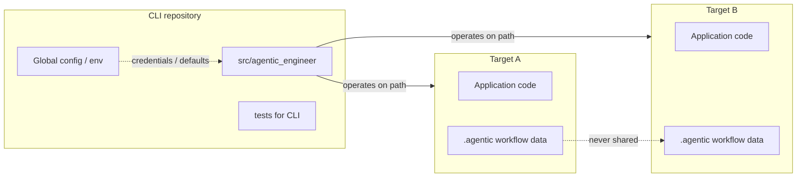
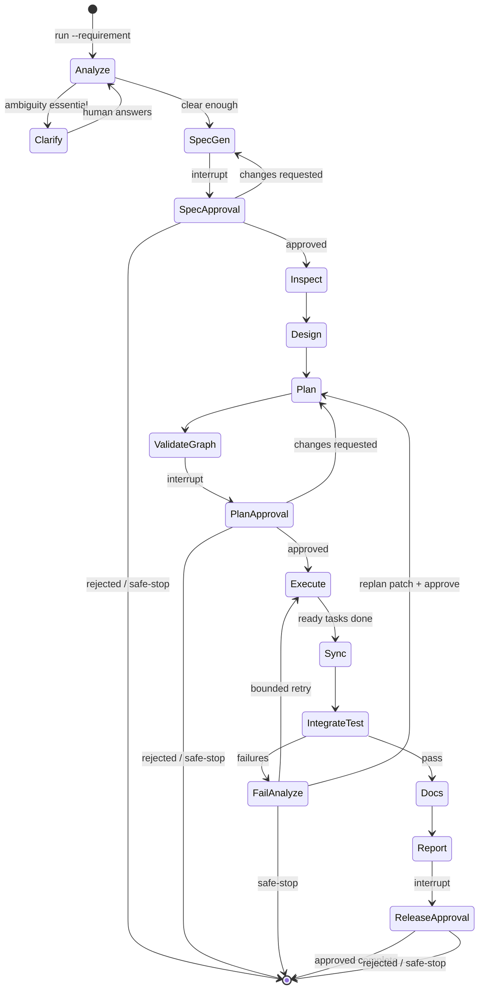
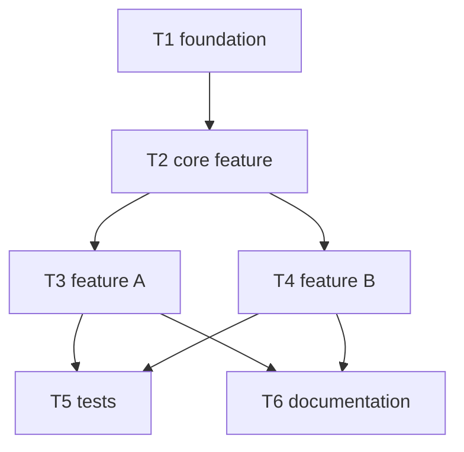

# Architecture

Architecture for the **Agentic Engineer** prototype: a standalone software-development CLI that creates, modifies, tests, and documents *other* projects under controlled autonomy.

**Status:** Phases 0–2 are the active delivery boundary. Phase 2 implementation + audit package: [docs/phase2/](docs/phase2/). Lead intends to **test and stabilize Phase 2**, then resume Phases 3+ later. Full architecture below remains the plan; later sections are not cancelled.

**Companion docs:** [IMPLEMENTATION_PLAN.md](IMPLEMENTATION_PLAN.md), [ARCHITECTURE_DECISIONS.md](ARCHITECTURE_DECISIONS.md), [REQUIREMENTS.md](REQUIREMENTS.md).

---

## 1. Product definition and boundaries

### What we are building

**Agentic Engineer** is a reusable, installable CLI (similar in *purpose* to Cursor’s agentic coding loop) that:

1. Accepts a natural-language requirement and a **target project path**.
2. Analyzes requirements, produces a reviewable specification, and waits for human approval.
3. Plans engineering tasks with an explicit dependency graph.
4. Orchestrates specialized agents via LangGraph to implement, test, recover, and document.
5. Leaves an auditable report and project-local workflow state under the target’s `.agentic/` directory.

The CLI is the product. Concrete demonstration target applications are **out of scope for the current architecture review** and will be defined later.

### What we are not building (now)

- A production multi-tenant platform, web dashboard, or queueing system.
- Any target application source inside this repository.
- Giving LLMs unrestricted shell access or the ability to approve their own work.
- A second custom DAG engine beside LangGraph.

### Two projects, strict separation

| | Project A — Agentic Engineer CLI | Project B — Target application |
| --- | --- | --- |
| **This repo** | Yes (`CharlesSchwabAssignment-abak` = CLI) | No |
| **Owns** | CLI, agents, LangGraph, governance, tools, LLM config | App source, deps, tests, docs, app config |
| **Runtime** | `agentic` CLI | App’s own entrypoint |
| **Must not** | Write target code into the CLI tree | Import CLI, LangGraph, or CLI agents |

Target apps are **siblings** of the CLI (or any path outside the CLI tree), for example:

```text
PycharmProjects/
├── CharlesSchwabAssignment-abak/   # this repo = agentic-engineer CLI
│   ├── src/agentic_engineer/
│   ├── tests/
│   ├── pyproject.toml
│   └── …
└── <target-project>/               # created/modified by the CLI (later)
    ├── src/
    ├── tests/
    └── .agentic/                   # project-local engineering metadata only
```

A later optional parent folder named `workspace/` is cosmetic; isolation is enforced by path rules, not by folder naming.

---

## 2. Goals and non-goals (prototype)

### Goals (essential)

- End-to-end path: requirement → analysis → spec → approvals → task graph → execution → tests → report.
- Explicit LangGraph orchestration with typed state, interrupts, and checkpoints.
- Deterministic dependency validation and bounded retries.
- Workspace isolation enforced in Python (not only in prompts).
- Human approval gates that LLMs cannot satisfy.
- Target projects remain independent of the CLI at runtime.

### Important but simplified

- Parallel task fan-out for independent tasks only (one sync barrier).
- Dynamic replanning as “patch plan + re-approve,” not a full planner rewrite loop.
- Metrics derived from the audit event log.
- Git: status inspect + workflow branch/commit checkpoint; no hard resets.
- LLM provider abstraction with mock + Anthropic (delivered in Phase 2; reuse later — do not rebuild).

### Deferred (later)

- Concrete demo target application(s), their stacks, APIs, and scenario scripts.
- Greenfield / brownfield / ambiguous end-to-end demos against a real app.
- Multi-provider routing / failover, prompt caching, vector retrieval (single Anthropic + mock already in Phase 2).
- Fine-grained per-command allowlists beyond a small safe set.
- Rich TUI / web UI for approvals.
- Distributed workers, Postgres/Redis, Kubernetes.
- Fully automatic large-scope replans without human approval.

---

## 3. Three architectural layers



| Layer | Responsibility | Must not |
| --- | --- | --- |
| **Intelligence** | LLM (or deterministic) reasoning that produces artifacts | Enforce policy, write outside Workspace, approve work |
| **Orchestration** | Graph transitions, interrupts, retries, routing, sync | Embed provider SDKs or raw `open()` paths |
| **Execution** | Files, commands, git, persistence I/O under policy | Call LLMs or decide workflow edges |

**Rule:** LLMs propose; Python decides and enforces.

---

## 4. CLI versus target workspace separation



### Workspace abstraction (execution layer)

`Workspace` is the **only** supported way agents and tools touch a target project.

It must:

- Resolve and canonicalize the target path (absolute or relative to CWD).
- Initialize missing or empty directories; inspect non-empty dirs and require confirmation.
- Create and own `.agentic/` under the target.
- Reject path traversal and symlink escapes outside the target root.
- Refuse if the target is the CLI repo root, or any path **inside** the CLI repo.
- Isolate workflow IDs and files per target so data cannot leak across projects.

Enforcement is in code and tests, not prompt text.

---

## 5. Component architecture

### 5.1 CLI surface (Typer)

| Command | Purpose |
| --- | --- |
| `agentic init <path>` | Create/confirm target + `.agentic/` |
| `agentic run <path> --requirement "..."` | Start or continue a workflow |
| `agentic status <path>` | Show phase, pending approvals, task summary |
| `agentic resume <path>` | Resume from LangGraph checkpoint / interrupt |
| `agentic spec <path>` | Show current specification |
| `agentic plan <path>` | Show task graph / plan |
| `agentic approve <path>` | Record human approval for pending gate |
| `agentic reject <path>` | Record rejection / changes-requested |
| `agentic report <path>` | Emit final (or partial) engineering report |
| `agentic history <path>` | Show audit events |

Commands always take an explicit project path and work from any CWD.

### 5.2 Intelligence — agents

| Agent | Role | Prototype stance |
| --- | --- | --- |
| Requirement Analyzer | Structured analysis; ambiguity / missing info | Full (Phase 2) |
| Specification Generator | Reviewable spec + acceptance criteria | Full (Phase 2) |
| Task Planner | Tasks + dependency graph | Full (Phase 3) |
| Architecture / Design | Inspect repo; recommend design / impact | Simplified inspect + LLM design note (Phase 4) |
| Developer | Scoped file create/modify | Full within Workspace (Phase 4) |
| Testing | Generate/run tests; report evidence | Full via controlled commands (Phase 4) |
| Failure Analysis | Root cause; retry vs replan recommendation | Full; cannot raise retry cap (Phase 4) |
| Documentation | App README / API notes + summary | Thin; final report node (Phase 5) |

Agents share a common interface: typed inputs → structured Pydantic outputs → side effects only through execution tools.

### 5.3 Orchestration — LangGraph

One primary `StateGraph` for the engineering workflow.

- **Typed shared state** (Pydantic / TypedDict): requirement, analysis, clarifications, spec, plan/graph, design, task statuses, test results, approvals, errors, metrics counters, stop reason.
- **Conditional edges:** ambiguity → clarify; approval pending → interrupt; failure → analyze → retry/replan/stop; success → next stage.
- **Parallelism:** fan-out ready independent tasks; barrier before integration/test.
- **Interrupts:** specification approval, plan approval, destructive-action approval, release approval.
- **Checkpointer:** file-based (or SQLite) LangGraph checkpointer keyed by target project + workflow/thread id — **separate** from application JSON artifacts under `.agentic/`.

Do **not** build a second DAG runner. The task dependency graph is **data**; Python validates it; LangGraph executes according to that validation.

### 5.4 Execution — tools

- `Workspace` path APIs (read/write/list) with containment checks.
- `CommandRunner`: argv allowlist / policy class, cwd fixed to workspace, timeout, captured stdout/stderr/exit, audit event.
- `GitSafety`: status, detect dirty tree, create workflow checkpoint branch/commit when safe; never `reset --hard` of user work.
- `JsonStore`: atomic write (temp + rename), schema version, per-workflow lock / single-writer.

### 5.5 Persistence layout (target-owned)

```text
<target>/
  .agentic/
    config.json
    specifications/spec_<id>.json
    plans/plan_<id>.json
    workflows/workflow_<id>/
      state.json                 # app-level mirror / summary
      task_graph.json
      approvals.json
      decisions.json
      execution_history.json     # audit events
      metrics.json               # derived snapshot
      checkpoints/               # LangGraph checkpointer files (or sibling sqlite)
    artifacts/
    reports/
```

Global CLI config (env + user config file) holds provider credentials and default models only — **no** target workflow state.

---

## 6. Workflow lifecycle



Illustrative only: edges are conditional; brownfield inserts deeper inspection/impact before plan; ambiguous flows spend more time in Clarify.

---

## 7. Dependency graph execution

Tasks are first-class records (id, name, type, deps, status, agent, I/O refs, acceptance criteria, retries, timestamps, errors).



Example shape only: T3 and T4 may run in parallel after T2; T5/T6 wait on their dependencies.

**Deterministic validation before any execution:**

- Missing / unknown dependency ids
- Cycles
- Orphan tasks with no path from roots (warn or reject per policy)
- Invalid status transitions
- “Dependencies complete” check before scheduling

**Execution rule:** a task is runnable only if all dependencies are `completed`. Independent ready tasks may run in parallel; dependents wait at the sync point.

**Replanning (simplified):** Failure Analysis may propose a plan patch (add/replace/invalidate downstream). Orchestration records the reason, preserves completed unaffected tasks, revalidates the graph, and requires human approval when scope/risk expands.

---

## 8. Human approval and governance

| Gate | When |
| --- | --- |
| Specification | After spec generation |
| Engineering plan | After validated task graph |
| Destructive / high-impact | e.g. delete trees, force git, broad rewrite |
| Release | After report, before “complete” |

Approval records: id, workflow id, type, requested action, decision (`pending` \| `approved` \| `rejected` \| `changes_requested`), comment, timestamp.

- LangGraph **interrupt** parks the graph until `agentic approve` / `reject` resumes with validated decision.
- Decision is written by CLI code from the human command — **never** from an LLM boolean.

---

## 9. Safety, retry, and recovery

| Concern | Prototype approach |
| --- | --- |
| Files | Workspace containment; reject traversal / symlink escape; refuse CLI self-target |
| Commands | Policy allowlist + timeout + capture; high-impact → approval |
| Git | Inspect dirty state; checkpoint on agentic branch; no destructive reset of user changes |
| Retries | Default max **2** automatic retries per task (configurable); Failure Analysis advises but cap is Python-enforced |
| Safe-stop | Rejected approval, isolation failure, unapproved destructive action, exhausted retries, unrecoverable conflict — persist state for investigate/resume |

---

## 10. Auditability and metrics

Append-only audit events (requirement submitted, spec generated, approval granted/rejected, task started/finished, files modified, command executed, tests run, retry, replan, safe-stop, completed, …) with id, workflow id, timestamp, type, optional task id, actor, details, outcome.

**Metrics** (computed from events, never fabricated): workflow/task success rates, retry count, rollback/checkpoint count, e2e latency, task durations, approval wait time, MTTR when recoverable failures exist. If data is insufficient, the report says so.

Final report summarizes requirement, approved spec, design notes, task graph, completed/failed tasks, files touched, commands, tests, retries/replans, risks, approvals, metrics, status.

---

## 11. Technology stack (proposed)

| Area | Choice |
| --- | --- |
| Language | Python 3.11+ |
| CLI | Typer |
| Validation | Pydantic v2 |
| Orchestration | LangGraph (`StateGraph`) |
| Persistence | Versioned JSON + atomic writes; LangGraph file/SQLite checkpointer |
| Tests | Pytest (+ mocked LLM) |
| VCS integration | Git via controlled wrapper |
| Logging | Structured logging (`logging` + JSON-friendly extras) |
| Config | Env vars + optional user config file |
| LLM | `LLMProvider` protocol; `mock` + `anthropic` (Phase 2) |

Avoid: K8s, Redis, Postgres, vector DBs, CrewAI/AutoGen, web dashboard, second orchestrator.

---

## 12. Proposed CLI package layout

```text
CharlesSchwabAssignment-abak/          # Agentic Engineer CLI
├── README.md
├── AGENTS.md
├── REQUIREMENTS.md
├── ARCHITECTURE.md
├── ARCHITECTURE_DECISIONS.md
├── IMPLEMENTATION_PLAN.md
├── pyproject.toml
├── src/agentic_engineer/
│   ├── __init__.py
│   ├── cli/                 # Typer commands
│   ├── config/
│   ├── models/              # Pydantic: spec, plan, task, approval, events
│   ├── workspace/           # Workspace + path safety
│   ├── persistence/         # JSON store, locks
│   ├── llm/                 # Provider abstraction: mock + anthropic (Phase 2)
│   ├── agents/              # Specialized agents + prompts/
│   ├── graph/               # LangGraph state, nodes, routing
│   ├── execution/           # commands, git
│   ├── governance/          # approvals, safe-stop
│   ├── audit/               # events + metrics derivation
│   └── reporting/
└── tests/
    ├── unit/
    ├── integration/
    └── fixtures/
```

Target applications are **never** under this tree.

---

## 13. Quality attributes

| Attribute | How we hit it in 5–6 hours |
| --- | --- |
| Correctness | Pytest on workspace, graph validation, approval paths; mocked LLM |
| Reviewability | `.agentic/` artifacts + `agentic report` |
| Controlled autonomy | Interrupts + deterministic caps |
| Isolation | Workspace tests (traversal, self-target, multi-target) |
| Recoverability | Checkpoints + resume + safe-stop |
| Independence | Target projects have zero runtime dependency on `agentic_engineer` |

---

## 14. Risks and trade-offs

| Risk | Mitigation |
| --- | --- |
| Scope too large for time | Phased delivery; defer demo apps and advanced replan/UI |
| LangGraph checkpoint vs JSON confusion | Document dual persistence; resume always via LangGraph thread id |
| LLM nondeterminism in demos | Golden mock transcripts for CI; live provider only for manual demo |
| Accidental CLI self-modification | Hard path checks comparing resolved target vs CLI package roots |
| Dirty git on existing targets | Stop and ask human rather than destructive cleanup |
| Over-agentization | Shared agent interface; thin Documentation/Architecture if needed |

---

## 15. Open items for lead approval

1. Confirm this repository is **only** the CLI; targets live outside.
2. Confirm stack: Python 3.11+, Typer, LangGraph, Pydantic, Pytest, JSON + LangGraph checkpointer.
3. Confirm simplified replan and metrics-from-audit approach.
4. Confirm default retry cap = 2.

Demo target application choice, stack, and scenarios are **deferred** — not part of this approval.

**Stop:** Phase 1 starts only after explicit approval.
